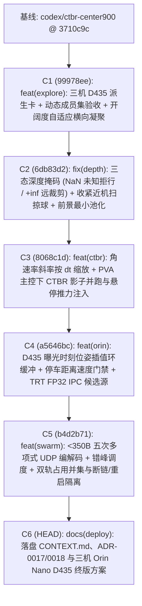

# restart-yopo 三机 Orin Nano 8GB 与 D435 实机部署方案

状态：report-only，判据未冻结。配置按三架同时飞行设计：每架各装一块 Jetson Orin Nano 8GB、一台前视 RealSense D435、一套独立 PX4 飞控与共基准双天线 RTK（室内预演可用动捕）。三机各自感知、规划和跟踪，地面站负责任务装载、状态监视、人工接管协调和日志汇总。首轮在开阔场验证三机刚性横队（`formation`），第二轮在开阔天空受控障碍场（人工软柱阵 / 稀疏林带 + 共基准 RTK）采用单一 `explore` 策略加开阔度自适应凝聚完成前视深度避障与 900 m 对标（`formation ↔ explore` 运行时动态策略切换仅作为未来开发项登记，当前不实现，见 [ADR 0017](../adr/0017-single-explore-policy-with-adaptive-cohesion.md)）。

## 1. 仿真对标值与已落盘基线

| 工况 | 仓库已有结果 | 真机对标方法 |
|---|---|---|
| 三机开阔区横队，虚拟中心直行、转弯 90°、再直行 | S5b 的 PX4 SITL 跑了 5 次，每次 3/3 到达并落地。各次槽位误差 P95 为 0.310–0.361 m，最小机间中心距 1.870–1.916 m，从全队进入编队阶段到到达用时 18.844–19.000 s。同卡简化动力学 L0 的 P95 为 0.027 m | 阶段 E 按同一虚拟中心、时基、槽位和统计窗口计算误差。外扩间距或降速后，以改卡后的三机 SITL 对照，原记录留作历史参照 |
| 六机密林，原生深度，弹性队形 | seed 0，75,616 根树干。任务设定 3.0 m/s，障碍带内按样本统计的平均速率 2.379 m/s。每机 CTBR 段水平位移 937.02–937.40 m，6/6 到达并降落。50 Hz 真值采样的碰撞数为 0，最小机体表面净空 0.169 m、最小机间中心距 2.277 m | 阶段 F 以派生三机卡 [explore-3-d435-center900.json](../../scenes/explore-3-d435-center900.json) 重新建立速度、耗时、净空、机间距和成功率基线（横向起飞间距 4.0 m，纵向凝聚跨度 8.0 m，开阔度自适应横向回归 `0.12 → 0.36`） |
| 相机与控制时序 | 密林场景原生深度 160×96、15 Hz，水平视场 90°，远裁剪 20 m。实际重规划 10–15 Hz，CTBR 反馈 50–100 Hz。历史 Orin GPU 金样的 TensorRT FP32 P50/P99 为 2.29/2.54 ms | 在三块板上分别测曝光、发布、规划、飞控接收的时间，加入无线时延、失序及丢包。整机墙钟实时性和单次 GPU 推理分别报告；目标每板重规划 P99 ≤ 25 ms（15 Hz）、控制计算 P99 ≤ 5 ms |
| D435 噪声实验 | 仓库 E-D435b 的三机交叉场景，仿真相机按 D435 原生焦距建模。噪声加空洞时 27/30 架到达，10 次中 1 次障碍碰撞。提高视差噪声并施加 50 ms 延迟时 18/30 架到达，10 次中 4 次障碍碰撞 | 用三台实物采集空洞、误深度、距离误差和延迟分布，重新回放与闭环。该实验采用另一张场景卡，不能据此推算密林实飞成功率 |

关联基线与代码证据：[六机验证报告](depth-only-dense-forest900.md) · [三机派生场景卡](../../scenes/explore-3-d435-center900.json) · [三机 S5b 对照](s5b-sitl-formation-verify.md) · [D435 噪声实验](e-d435b-native.md) · [Orin 金样与计时口径](../ref/golden.md) · [领域术语表](../../CONTEXT.md)。

## 2. 单机接线、安装与定位（D1 已拍板：开阔天空受控障碍场 + 共基准 RTK）

| 每架的部件 | 装机与验收 |
|---|---|
| Orin Nano 8GB、载板、散热、存储 | 使用有固定件和散热通道的载板，NVMe 固定并设日志容量上限。按载板输入范围配独立滤波 DC/DC。预算含模块、载板、D435、无线、风扇和存储的峰值负载，留瞬态余量。带全载实测输入电压、峰值电流、温度、时钟及剩余航时。飞控供电单独验证，伴随计算机重启不能拖垮飞控 |
| D435 ×1 | 短 USB 3 线锁紧直连并做应力释放。安装后检查桨叶、机臂和护圈是否进入 160×96 深度视场。记录序列号、固件、活动流的内参、相机到机体的六自由度外参 `extrinsic_rotation_body_cam` / `mount_xyz_body` 和安装照片。三架各做一次标定 |
| PX4 飞控 ×1 + 下视激光定高 | 选有对应板级构建和高速串口（3 Mbps）或以太网 uXRCE-DDS 支持的硬件。PX4 保留状态估计、角速率内环、飞行模式、人工接管与故障保护（台架基线设 `COM_OF_LOSS_T = 0.25 s`，算法运行期保持 `px4_parameters_written == []`）。每架有可独立识别和验证的 RC 接管通道 |
| 定位与独立参照（已拍板路线 A） | **首轮及 900 m 验收定在开阔天空下的受控障碍场（人工软柱阵 / 稀疏林带）+ 共基准双天线 RTK（室内预演用动捕）**。D435 本体无内置 IMU，**严禁在无硬件触发同步下将 USB 深度帧与飞控串口 IMU 软拼 VIO**；未来若进入遮挡 GNSS 密林，须先换装自带硬件同步 IMU 的传感器（如 D455/D435i 或 Mid-360） |
| 机间无线与地面站 | 一架一个身份与地址。飞控 uXRCE/ROS 话题锁在本机（`ROS_LOCALHOST_ONLY=1`），跨机只经 `yopo_l0/swarm_udp.py` 放行紧凑多项式轨迹包（`< 350 B`）及队伍状态摘要。板载记录深度，断地面站与断机间链路分别试验 |

D435 的双目深度采用全局快门，基线 50 mm。原场景 20 m 远裁剪属于仿真条件。拿三台 D435 同时上电，在顺光、逆光、暗部、低纹理、细杆和近距离遮挡条件下测出**可靠净视距（RCH）**，再按 `yopo_l0/d435_live.py` 的 `StoppingDistanceGate` 决定试验航速。

## 3. 软件基线和 8GB 板内存/实时纪律

1. **镜像与 BSP 选择。** 若三块板新刷系统，优先选 **JetPack 6.2.x（L4T R36.4/R36.5、Ubuntu 22.04、CUDA 12.6、TensorRT 10.x）**，可在原生 Jammy 上直接运行 ROS 2 Humble、D435 原生 V4L2 元数据补丁及重新构建的 TensorRT FP32 engine；若沿用项目已有 GPU 金样对应的 **L4T R39.2.1（JetPack 7.2.1、Ubuntu 24.04、CUDA 13.2、TensorRT 10.16）**，则用 ARM64 Jammy 容器跑 ROS 2 Humble，经本机 Unix 域套接字（`yopo_l0/d435_live.py` 的 `IpcCandidateSource`）连推理服务。
2. **8GB 统一内存防换页铁律。** Orin Nano 8GB 的 CPU 与 GPU 共享同一块 8 GB 内存：
   - 阶段 B 离线台架对账可加载 PyTorch 核对 `L0_cpu_fp32` / `L1_cuda_fp32` / `L2_trt_fp32` 金样（`rtol=1e-4, atol=1e-5`）；
   - **进入阶段 C–F 实时闭环与实飞时，关闭桌面 GUI（`multi-user.target`），推理服务仅加载 TensorRT FP32 `.engine`（不常驻加载 `torch` CUDA 上下文，节省约 1.4 GB 内存）**，防止飞行中途页缓存涨满触发 `kswapd` 换页毛刺。
3. **保留 TRT FP32。** 历史 Orin 金样中 `L2_trt_fp32` 的 P50/P99 已达 `2.29 / 2.54 ms`，完全满足 15 Hz 规划预算（即使单拍评估 2 个引导点也仅约 `5 ms`），且避免了 FP16 在多机森林临界帧因分数舍入误差引发的轨迹分叉（见 [P1 推理耗时分析](p1-inference-speed.md)）。

## 4. 从相机、里程计到三态安全轨迹

1. **双路差异化视场边缘与三态深度掩码（`yopo_l0/depth_accel.py` & `yopo_l0/depth_local.py`）。**
   D435 校正重投影至 160×96（`fx=fy=80, cx=80, cy=48`）后，针对真实水平视场（约 85.2°）窄于训练视场（90°）的外侧边缘列及双目空洞执行双路分流（`prepare_d435_dual_depth`）：
   - **网络输入路**：外侧窄视场边缘采用最外侧有效列复制延拓（`BORDER_REPLICATE`）后再做 NS 填洞，防止 `u8=0` 被网络误读为贴脸实体墙而封死外侧 `±30°` 绕障基元；
   - **几何安全检查路（三态深度掩码 `strict_unknown=True`）**：严格区分**观测表面（有限深度）**、**已验证远距自由空间（`+inf`）**与**未知盲区（`NaN`，含遮挡、曝光失效、`< MinZ` 近距盲区及窄视场外侧边缘）**。未知盲区强制 `known = False`；近机已扫掠球半径从仿真默认的 `1.2 m` 收紧至实际 `body_radius_m`（`0.35 m`）。高分辨率深度降采样采用前景最小池化（`conservative_foreground_downsample`），确保细杆不被跨像素漏检。
2. **曝光时刻位姿插值与跳变失效（`yopo_l0/d435_live.py`）。**
   `PoseRingBuffer` 按单调时钟维护位姿环缓冲，在 D435 硬件曝光时间戳 $t_{\text{exp}}$ 处插值飞机位置与 $\mathrm{SO}(3)$ 姿态，再乘入完整相机外参 `cam_rotation` 投影点云；控制跟踪仍取最新有效里程计。若检测到时钟倒退、里程计断流（`> 0.25 s`）或 EKF 位置跳变，立即使位姿环与旧点云失效并退回保守制动。
3. **停车距离硬门禁（`StoppingDistanceGate`）。**
   对各速度档强制执行 `可靠净视距 RCH ≥ 速度 × 响应延迟 + 实测制动距离 + 机体及误差余量`。例如在 `3.0 m/s`、响应延迟 `0.15 s`、实测制动距离 `2.25 m`、外廓及误差余量 `0.70 m` 下，要求 `RCH ≥ 3.40 m`；若当日对试验场最细障碍实测 `RCH = 3.00 m`，则由 `max_safe_speed_mps(3.00)` 自动将允许目标航速压回 `≤ 2.68 m/s`。

## 5. 三机编队、错峰双轨协同与控制交接

1. **阶段 E 开阔横队与阶段 F 单一 `explore` 弹性横队（D2 已拍板，[ADR 0017](../adr/0017-single-explore-policy-with-adaptive-cohesion.md)）。**
   - 阶段 E 单独运行 `FormationFleet`（`policy=formation`）验证开阔区刚性槽位跟踪；
   - 阶段 F 全程运行 `ExploreFleet`（`policy=explore`），由 `ExploreFleet.effective_lateral_gain` 按前方扇区深度开阔度在 `[0.12, 0.36]` 间平滑插值：障碍区内放开横向绕障，离开障碍区视野开阔后自动拉回初始横排通道；纵向由 `max_progress_span_m = 8.0 m` 触发超前机 `COHESION_BRAKE` 等待。
   - *未来开发项（当前不实现）*：`FormationFleet` 预积分虚拟中心时刻表与 `ExploreFleet` 之间的空中运行时策略动态切换。
2. **对时错峰单向广播与双轨占用并集（D3 已拍板，[ADR 0018](../adr/0018-staggered-broadcast-dual-track-over-ack-mutex.md)，`yopo_l0/swarm_udp.py`）。**
   - 三块 Orin Nano 经局域网对时后，由 `StaggeredSlotScheduler` 按固定相位槽错峰触发重规划（10 Hz 下 `0 / 33.3 / 66.7 ms`，15 Hz 下 `0 / 22.2 / 44.4 ms`）；
   - 本机重规划通过后**立即本地生效**，并用 `encode_poly_packet` 单向广播 `< 350 B` 的五次多项式系数包（含 `coord_version, session_id, owner, seq, t_gen, t_start, t_expire, terminal_goal` 及 CRC32），无需等待邻机双向 ACK；
   - 接收端 `DualTrackPeerTable` 在网络时延窗口 `delay_union_s = 0.05 s` 内同时保留邻机“上一条已提交计划 + 新收到计划（均含制动尾与末端保持）”的**双轨占用并集**；旧序号、乱序、坏时间戳和跨版本坐标一律拒收；邻机失联超 `0.15 s` 后按 `uncertainty_speed_mps * age` 动态膨胀禁入半径；同一机号变更 `session_id` 重启时自动隔离该邻机，直至人工重新核对身份与坐标。
3. **PVA 主控 + CTBR 影子并跑 → CTBR 实控两步上机（`yopo_l0/ctbr.py` & `yopo_l0/sitl_bridge.py`）。**
   - 首轮实飞开启 `--control-mode pva --ctbr-shadow`：由 PX4 PVA 外环保底跟踪，后台并行运行 `FlatnessCTBRController` 记录 `ctbr_shadow_rates` 与 `HoverThrustEstimate` 在线标定值；
   - 台架与单机核验无误后切入 `--control-mode ctbr`：角速率斜率限幅按实测步长 `max_rate_acc * dt` 动态缩放；进入终点区锁定 `_terminal_goal` 后由 `slot.ctbr_finished = True` 单向锁存切回 PVA 完成减速保持与 `NAV_LAND`。

## 6. 开发树（Development Tree）与已落地 Commit 清单

所有代码修改均位于 `yopo_l0/`、`scenes/`、`tests/` 与 `docs/` 外围层，`core/` 59 个冻结文件与 `scenes/suite.txt` 保持零改动（`git diff --quiet 8b470d3 -- core scenes/suite.txt` 通过）。

| Commit | 交付模块与测试文件 | 实测验证结果 |
|---|---|---|
| `C1` (`99978ee`) | `scenes/explore-3-d435-center900.json`, `yopo_l0/explore.py`, `yopo_l0/flight_evidence.py`, `tests/test_explore_3uav_d435.py` | `8 passed`，三机 ID 集合动态校验与开阔度自适应 `lateral_gain` 通过 |
| `C2` (`6db83d2`) | `yopo_l0/depth_local.py`, `yopo_l0/depth_accel.py`, `yopo_l0/explore.py`, `tests/test_depth_only.py` | `14 passed`，贴脸 `NaN` 盲区拒行、近机 `0.35 m` 扫掠半径、细杆前景最小池化与双路窄视场边界通过 |
| `C3` (`8068c1d`) | `yopo_l0/ctbr.py`, `yopo_l0/sitl_bridge.py`, `scripts/sitl/yopo_l0_live.py`, `tests/test_ctbr_flatness.py` | `9 passed`，`dt` 自适应角加速度限幅与 `--ctbr-shadow` 并行记录通过 |
| `C4` (`a5646bc`) | `yopo_l0/d435_live.py`, `tests/test_d435_live.py` | `3 passed`，曝光位姿插值、EKF 跳变失效、停车距离门禁与 Unix 套接字 IPC 金样往返通过 |
| `C5` (`b4d2b71`) | `yopo_l0/swarm_udp.py`, `tests/test_swarm_udp_faults.py` | `3 passed`，`< 350 B` CRC32 报文、三机错峰相位、双轨并集防撞、单向失联膨胀与同机重启隔离通过 |
| `C6` (`HEAD`) | `CONTEXT.md`, `docs/adr/0017-*.md`, `docs/adr/0018-*.md`, `docs/research/orin-nano-3uav-d435.md` | 四项仓库必检（场景严格校验、文档链接、研究索引、一期收口核验）全部 PASS |

## 7. 分阶段实机验收表

| 阶段 | 执行内容 | 进入下一阶段的证据 |
|---|---|---|
| A．三机仿真基线 | 阶段 E 复用 S5b 开阔横队；阶段 F 运行 `scenes/explore-3-d435-center900.json`，保留场景几何仅供仿真与独立裁判 | 三机 3/3 到达降落，碰撞 0，`all_arrived` 与 `all_native_depth_streams_consumed` 按三机 ID 集合核验通过 |
| B．三板回放与台架 | 同一数据分别过 CPU FP32、Torch CUDA、TRT FP32；加入三台真实 D435 地面移动数据；电池供电全载热跑 ≥ 30 min | FP32 金样满足 `rtol=1e-4, atol=1e-5`；实拍空洞和视场外区域不放行新轨迹；无降频与换页抖动 |
| C．三板实时闭环 | PC 跑环境与动力学，三块 Nano 按真实墙钟各处理一机（仅加载 TRT FP32 engine）；经真实无线跑 `swarm_udp.py` | 相机消费 15 Hz、重规划 15 Hz（P99 ≤ 25 ms）、控制跟踪 50–100 Hz（P99 ≤ 5 ms）；单向断链与重启隔离验证通过 |
| D．单机与双机 | 开阔受控场 + 共基准 RTK：先单机 `--control-mode pva --ctbr-shadow` 测 RCH、停距与影子角速率，再切 `--control-mode ctbr` 过软柱 | 飞控 ULog 与独立 RTK 位置闭合；实测停距满足 `StoppingDistanceGate`；双机错峰广播与失联膨胀无相交占用 |
| E．三机开阔编队 | 三个独立起降点跑 `formation` 直行、转弯、停车、单机退出 | 连续 5 次 3/3 到达降落，记录每机及全队槽位误差 P95（首版目标 ≤ 0.50 m） |
| F．三机弹性避障与距离扩展 | 全程跑 `explore`（自适应横向凝聚 + 错峰双轨广播），从 80–150 m 软柱阵分级扩展至 900 m 对标场；高位伴飞/三脚架同步录制画面合成 HUD 回放 | 3/3 到达降落，碰撞 0；按实测 RCH 速度上限闭合净空、间距与停距；产出与仿真同格式的 HUD 标注视频及 `flight-replay.html` |
